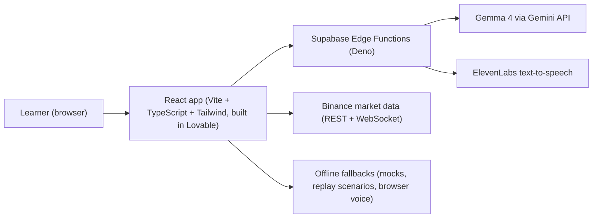

# Aquila – Trade with a reason, not a hunch.

Aquila is a Duolingo-style app that teaches trading. You learn in short lessons, practise paper trading on real market data, and an AI coach – an eagle called Aquila, powered by the open-weight model **Gemma 4** – grades the **reasoning** behind each trade, not the profit.

> **Educational only.** Aquila is not financial advice. No real money is used, and nothing in the app recommends buying or selling any real asset.

## Why it matters

- **Most retail traders lose money.** In the EU, brokers offering CFDs (a leveraged product) must publish the share of retail accounts that lose money, and those figures are commonly above 70%.
- **Trading apps make it easy to gamble and hard to learn.** One lucky win can teach exactly the wrong lesson.
- **We teach process, not predictions.** Aquila rewards a clear thesis, a stop loss in the right place and sensible position sizing, and it calls out a profitable trade that was really just luck.

## Features

- **Lessons** – six bite-sized beginner lessons (candles, trends, support and resistance, stop losses, position sizing, mindset) with XP, streaks and hearts.
- **Next Candle game** – guess the next candle on real historical charts, then get an AI tip.
- **Paper trading** – live Binance market data, plus a **Replay mode** that plays curated historical scenarios at 1x, 2x or 4x. Every trade needs a written thesis.
- **Gemma 4 trade review** – after you close a trade, Gemma 4 scores your reasoning (0–100) and gives a verdict: *great, good, lucky, unlucky* or *poor*.
- **Gemma 4 chart vision** – upload a chart screenshot (or try a sample) and get the pattern, trend, key levels and a follow-up question.
- **Adaptive quizzes** – the Practice page generates fresh questions per topic and difficulty.
- **ElevenLabs voice coach** – Aquila reads its verdict aloud in a calm, warm voice, with replay and mute buttons and a browser-voice fallback.
- **"Ask Aquila" voice coach** – the Coach page lets you ask trading questions by voice or text and hear the answer in Aquila's voice.
- **Works offline** – every AI call falls back to built-in content (marked "Offline coach"), and Replay mode needs no network.

## How AI is used

| Feature | Model | Where |
|---|---|---|
| Trade review | Gemma 4 | `review-trade` edge function |
| Chart vision | Gemma 4 (image input) | `analyze-chart` edge function |
| Adaptive quizzes and Next Candle tips | Gemma 4 | `generate-quiz` edge function |
| Coach voice | ElevenLabs `eleven_flash_v2_5` | `speak` edge function |

- **Gemma 4 is an open-weight model.** We call it through the Gemini API. The prompts are in the [`prompts/`](prompts/) folder, so anyone can read exactly how the coach is instructed.
- **Responses use a fixed JSON shape** (see [`src/lib/contracts.ts`](src/lib/contracts.ts)), so the UI never depends on free-form AI text.
- **The UI shows a "Gemma 4" badge** when an answer came from the model and an "Offline coach" badge when it came from the fallback.

## Architecture



## Tech stack

- **Frontend:** React 19, TanStack Start/Router, TypeScript, Tailwind CSS, lightweight-charts, built with [Lovable](https://lovable.dev)
- **Backend:** Supabase Edge Functions (Deno)
- **AI:** Gemma 4 (open weights, via the Gemini API)
- **Voice:** ElevenLabs text-to-speech and Agents
- **Market data:** Binance public REST and WebSocket APIs

## Run locally

Requirements: Node.js 20+ (or Bun) and Deno 2. To deploy functions yourself you also need the Supabase CLI.

```sh
git clone https://github.com/TimDev-r/aquila.git
cd aquila
npm install
npm run dev
```

The app runs without a backend: AI features fall back to built-in content and the voice falls back to the browser's speech engine.

To listen to the coach voice without deploying anything, put your ElevenLabs key in `.env.local` and run:

```sh
deno run -A --env-file=.env.local supabase/functions/speak/selftest.ts
```

This writes `speak-test.local.mp3`, which is git-ignored.

## Environment variables

Names only. Never commit values. `.env.local` is git-ignored.

| Variable | Used by |
|---|---|
| `VITE_SUPABASE_URL` | Frontend: Supabase project URL |
| `VITE_SUPABASE_PUBLISHABLE_KEY` | Frontend: Supabase public (anon) key |
| `SUPABASE_URL`, `SUPABASE_ANON_KEY` | Local scripts that call deployed functions |
| `GEMINI_API_KEY` | Edge functions: Gemma 4 via the Gemini API |
| `ELEVENLABS_API_KEY` | `speak` edge function |
| `ELEVENLABS_VOICE_ID` | `speak` edge function: Aquila's voice |

## Team

| Role | Owns |
|---|---|
| Person 1 – UI and app shell | React app in Lovable, design, config |
| Person 2 – AI | Gemma 4 edge functions and prompts |
| Person 3 – Market data and trading | Binance data, replay scenarios, paper-trading engine, test scripts |
| Person 4 – Voice, lessons, QA and pitch | ElevenLabs voice, lesson content, docs, QA, demo |

## License

Our code is released under the [MIT License](LICENSE).

Gemma model weights are not part of this repository. They are provided by Google under the [Gemma Terms of Use](https://ai.google.dev/gemma/terms), which apply separately from our MIT license.
